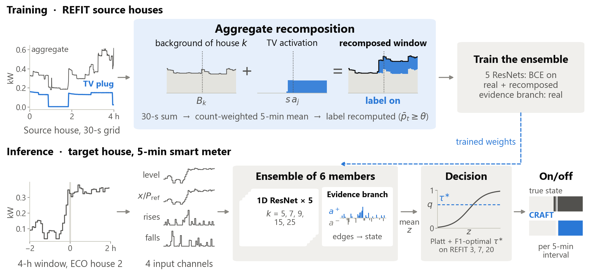
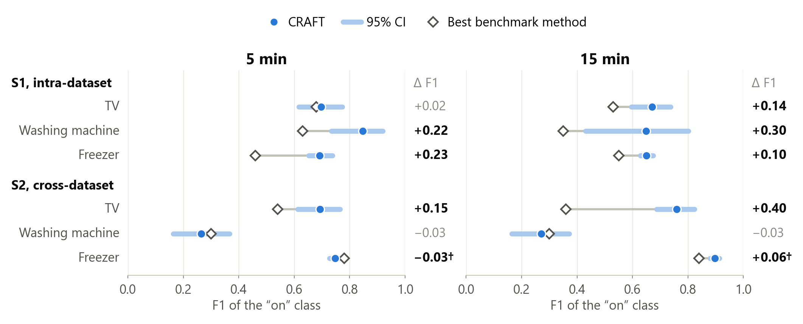

**English** | [Português](README.pt-BR.md)

# CRAFT

**Appliance on/off detection from 5- and 15-min smart meter data, trained on recomposed aggregates.**

Code for the manuscript *NILM from Low-Rate Smart Meter Data by Aggregate Recomposition*
(Emiliano D. S. C. Lima and Ricardo A. S. Fernandes, EESC, University of São Paulo).

## Overview

Deployed smart meters store one average every 5 to 15 min. At these rates appliance
signatures blur: a 70 W television becomes a small step on an aggregate of several hundred
watts, and a washing-machine cycle shrinks to a handful of samples. The benchmark of
Chatterjee and Heer (2025, *Energy and Buildings*, doi:10.1016/j.enbuild.2025.116002)
trained six NILM algorithms on one year of REFIT house 8. Tested on Swiss ECO houses, its
best F1 at 5 min was only 0.54 for the television and 0.30 for the washing machine, and
lower still at 15 min. Models trained on one house learn its habits (usage hours,
appliances that run together), and those habits do not carry over to another house.

CRAFT is a per-appliance binary classifier. It reads a 4-h window of the aggregate (48
intervals at 5 min, 16 at 15 min), predicts whether the target appliance is on in the
central interval, and is trained on the benchmark's own data (one year of REFIT house 8).
It has three components:

1. **Aggregate recomposition with recomputed labels.** Training data sit on a 30-s grid that
   stores each bin's mean power and native sample count. The generator builds new windows
   by adding and removing real signals on that grid: it swaps the background (target plug
   over the background of another day), injects a scaled real activation at a random phase,
   removes the target, or injects a confusable distractor. It then resamples to 5 or 15 min,
   weighting by sample count, and recomputes the label with the benchmark's rule (mean plug
   power ≥ 10 W for TV and freezer, ≥ 20 W for the washing machine). Each recomposed window
   changes one factor and keeps the others, so the model cannot rely on co-occurrence and
   has to use the appliance's own signature. About 40% of each batch is real windows.
2. **An ensemble of five 1D ResNets.** Three residual blocks (32/64/64 channels); the five
   networks differ only in the first kernel width of each block (k = 5, 7, 9, 15, 25). Four
   input channels: the house-normalised asinh level, and the level, rises and falls in units
   of the target's typical power `P_ref`. No hour-of-day input; 0.79 M parameters in total.
3. **An evidence branch as a sixth member.** Two small sign-constrained edge detectors score
   rising and falling edges; the rising-edge detector sees only positive differences, so a
   drop in the aggregate can never read as "switched on". A bidirectional accumulator with a
   learned decay turns edges into an on-state. A few hundred parameters.

The score is the mean of the six logits. The decision applies Platt scaling and the
F1-optimal threshold, fitted on labelled data used neither for training nor for testing:
rule `d_L` (cross-dataset cells) on REFIT houses 3, 7 and 20; rule `d_A` (intra-dataset
cells) on the last four weeks of the training year.



## Main results

Test F1 of the "on" class, mean of 10 seeds, CRAFT trained on REFIT house 8 only.
**Bench.** is the best of the benchmark's six methods at the same rate. **S1**
(intra-dataset): REFIT house 8, the month after training. **S2** (cross-dataset): ECO
houses, Switzerland, June 2012.

| Scenario | Appliance | 5 min Bench. | 5 min CRAFT | 15 min Bench. | 15 min CRAFT |
|---|---|---|---|---|---|
| S1 intra | TV | 0.68 | 0.70 (tie) | 0.53 | **0.67** |
| S1 intra | Washing machine | 0.63 | **0.85** | 0.35 | **0.65** |
| S1 intra | Freezer | 0.46 | **0.69** | 0.55 | **0.65** |
| S2 cross | TV | 0.54 | **0.69** | 0.36 | **0.76** |
| S2 cross | Washing machine | 0.30 | 0.27 (tie) | 0.30 | 0.27 (tie) |
| S2 cross | Freezer | 0.78 | *0.75* (below)† | 0.84 | **0.90**† |

Bold: exceeds the benchmark (higher F1, Holm-corrected p < 0.05). Italics: below it.
†: not above the F1 of a classifier that always predicts "on".



Caveats stated in the manuscript:

- **Freezer, cross-dataset, 5 min:** 0.75, below the benchmark (0.78) and the all-on
  classifier (0.79); the house 8 freezer does not transfer to Swiss freezers.
- **Freezer at 15 min:** neither win carries information about the freezer. Cross-dataset,
  CRAFT predicted "on" everywhere, so its F1 equals the all-on classifier's (0.90), which is
  itself above the benchmark (0.84). Intra-dataset, it beats all-on by only 0.04 (0.65 vs. 0.61).
- **Washing machine, cross-dataset:** inconclusive at both rates (0.27 vs. 0.30); one
  training house offers few cycles (on 4% of the time) and one program mix.
- **Computer and kettle:** degenerate benchmark cells, excluded. The house 8 computer is on
  in 100% of intervals; the kettle never reaches its 2 kW threshold in a 5- or 15-min mean.
- **TV cross-dataset:** one ECO house (39 activations), whose aggregate records almost the
  whole TV step.
- **Test reuse:** the 5-min ECO and house 8 test data were queried in 26 logged runs during
  development; the 15-min run uses the same houses and months, so it is not an independent test.

**UK-DALE (5 min, no published reference),** trained on house 1, March 2013 to March 2014:

| Appliance | Intra-house (house 1, next month) | Cross-house (house 2) |
|---|---|---|
| Fridge | 0.83 | 0.80 |
| Dishwasher | 0.96 | 0.40 |
| Washing machine (washer dryer in house 1) | 0.94 | 0.14 |

The final per-cell results behind these tables (F1, 95% CI, p-values, AUC, prevalence,
fraction predicted "on", for every decision rule, with and without the evidence branch) are
shipped in `resultados/v3/`: `final_craftE__celulas.csv` (5 min), `final_craftE15__celulas.csv`
(15 min), `comparacao_5x15__celulas.csv` and `final_ukdale_s__celulas.csv`. The manuscript
reports band `A` and the pre-registered rule of each cell (see the glossary below).

## Evaluation protocol

- **Pre-registration.** Before each test run, a file fixed the final model, decision rules,
  comparisons and expected outcome of each cell; its hash was logged. The 15-min run had its
  own pre-registration, written before any 15-min test data was opened.
- **Validation only.** All design choices were made on REFIT houses 3, 7 and 20
  (leave-one-house-out) and the last four weeks of house 8; no ECO or test-month data was
  used before the test.
- **Seeds and metric.** 10 seeds per cell, mean F1 reported. F1 comes from TP/FP/FN pooled
  over all test intervals of the cell, reported with the prevalence π and the all-on F1 `2π/(1+π)`.
- **Uncertainty.** 2000 bootstrap replicates resampling one-day blocks (starting at noon)
  together with seeds. The two-sided p-value against the benchmark is Holm-corrected within
  each pre-registered family; a win or loss needs corrected p < 0.05, otherwise it is a tie.

## Datasets

Raw data are not distributed. Download them and place them under `datasets/` (git-ignored).

| Dataset | Used for | Source |
|---|---|---|
| REFIT (cleaned, `CLEAN_REFIT_081116`) | training (house 8), validation and calibration (houses 3, 7, 20), S1 test | https://doi.org/10.15129/9ab14b0e-19ac-4279-938f-27f643078cec |
| ECO | S2 test (houses 1, 2, 5; 2 Jun to 1 Jul 2012) | https://vs.inf.ethz.ch/res/show.html?what=eco-data |
| UK-DALE (`ukdale.h5`, NILMTK HDF5) | UK-DALE scenarios (houses 1, 2, 5) | https://jack-kelly.com/data/ |
| REDD (`redd.h5`, converted with NILMTK) | optional extra scenario, not in the manuscript | http://redd.csail.mit.edu/ |

```
datasets/
├── refit/CLEAN_REFIT_081116/{CLEAN_House1.csv ... CLEAN_House21.csv, MetaData_Tables.xlsx}
├── ECO/
│   ├── 01_sm_csv/01/2012-06-02.csv ...          # smart meter, one CSV per day
│   ├── 01_plugs_csv/01/<plug>/2012-06-02.csv ... # plugs, e.g. 01_plugs_csv/01/05/
│   └── 02_..., 05_... (same layout; 0X_doc.txt optional)
├── ukdale.h5
└── redd.h5                                       # optional
```

The preparation scripts write `datasets/protocolo_artigo/` (5/15-min protocol files) and
`datasets/v3_fino/` (30-s grids). Without an ECO `0X_doc.txt`, the plug map falls back to
the NILMTK metadata hard-coded in `scripts/preparar_artigo.py`.

## Installation

```bash
python -m venv .venv && source .venv/bin/activate   # Windows: .venv\Scripts\activate
# install PyTorch for your CUDA version first (https://pytorch.org), then:
pip install -r requirements.txt
```

Reported runs: Python 3.11, PyTorch 2.13 (CUDA 12.6), NumPy 2.4, scikit-learn 1.7, one
NVIDIA RTX 3080 Ti, 2 to 8 min per member and seed. The code uses CUDA when available and
otherwise the CPU (`src/treino.py`); no CPU-only run was made.

## How to reproduce

Run from the repository root (Git Bash or similar for `VAR=value command`; in PowerShell use
`$env:NILM_TAXA=900`). Code identifiers are Portuguese:

| Code | Manuscript |
|---|---|
| `CRAFT+E` | CRAFT (`CRAFT` in the result files = the five ResNets without the evidence branch) |
| `G5` ... `G25` / `A2` | the five ResNets / the evidence branch |
| `--fonte A` (band A) | training on REFIT house 8 only; band `A+` adds REFIT houses and is not in the manuscript |
| `d_A`, `d_L`, `q` | decision rules |
| `intra` / `cross` | S1 / S2 |

**1. Prepare the data.**

```bash
python scripts/preparar_artigo.py --casas_refit 8,3,7,20   # 5/15-min protocol files, REFIT + ECO 1/2/5
python scripts/auditoria_p0.py --casas_refit 8,3,7,20      # gap masks; also rewrites resultados/p0_*.csv
python scripts/preparar_v3.py --casas 8,3,7,20             # 30-s grids for the recomposition generator
```

**2. Train (5 min, band A, 10 seeds).** The tags below are those of the original runs, so
the shipped pre-registration finds them. `--olhar_teste` also predicts on the test cells and
appends one line per appliance to the test-look log `resultados/v2/olhadas.csv`. Predictions
go to `resultados/v3/pred/<tag>/` (ResNets) and `resultados/v2/pred/<tag>/` (evidence branch).

```bash
python src/experimento_reco.py --aparelhos "television,washing machine" --modelos G5,G7,G9,G15,G25 \
  --fonte A --sementes 10 --lotes_epoca 400 --passo 4 --olhar_teste --tag craftF_A
python src/experimento_reco.py --aparelhos freezer --modelos G5,G7,G9,G15,G25 \
  --fonte A --sementes 10 --lotes_epoca 400 --passo 4 --olhar_teste --tag craftE_A_fz
python src/experimento_evicon.py --aparelhos "television,freezer" --modelos A2 --fonte A \
  --sementes 10 --epocas 40 --paciencia 6 --passo 4 --olhar_teste --tag craftE_A_ev
python src/experimento_evicon.py --aparelhos "washing machine" --modelos A2 --fonte A \
  --sementes 10 --epocas 40 --paciencia 6 --passo 4 --olhar_teste --tag final_A
```

**3. Analyse.** `src/final_craftE.py` combines the six members per seed, applies the rules,
runs the bootstrap and Holm tests, and writes `resultados/v3/<name>__celulas.csv` (`<name>` =
the pre-registration file name with `preregistro_` replaced by `final_`).

```bash
python src/final_craftE.py --preregistro resultados/v3/preregistro_craftE.json
```

The shipped pre-registrations (`preregistro_craftE.json`, `preregistro_craftE15.json`) hold
the seeds (`sementes`), the primary rule per cell type (`regra_primaria`), the Holm family
(`familia_primaria`), the run tags per band and appliance (`execucoes`), the exact training
commands (`rodadas_novas`), the expected outcomes and the hash. They also list band-A+ runs:
in the manuscript, the intra-dataset cells were Holm-corrected in a family of six together
with three band-A+ cells, so reproducing those p-values exactly requires the A+ runs listed
there. Missing runs are reported as warnings and the remaining cells are still analysed.
**Re-running overwrites the shipped `*__celulas.csv`.**

**4. 15 min.** Same configuration with `NILM_TAXA=900`, a 16-interval context and stride 1
(full list, including band A+, in `rodadas_novas` of `preregistro_craftE15.json`):

```bash
for p in "television tv" "washing_machine wm" "freezer fz"; do set -- $p
  NILM_TAXA=900 python src/experimento_reco.py --aparelhos "${1//_/ }" --modelos G5,G7,G9,G15,G25 \
    --fonte A --sementes 10 --epocas 30 --paciencia 5 --lotes_epoca 400 --ctx 16 --passo 1 \
    --olhar_teste --tag c15_A_$2
done
NILM_TAXA=900 python src/experimento_evicon.py --aparelhos "television,washing machine,freezer" \
  --modelos A2 --fonte A --sementes 10 --epocas 40 --paciencia 6 --passo 1 --olhar_teste --tag c15_A_ev
NILM_TAXA=900 python src/final_craftE.py --preregistro resultados/v3/preregistro_craftE15.json
python src/comparar_taxas.py          # -> resultados/v3/comparacao_5x15__celulas.csv
```

**5. UK-DALE scenarios** (the manuscript's S3/S4 are S4/S5 in the code; design in
`resultados/v3/preregistro_ukdale_s.json`):

```bash
python scripts/preparar_ukdale_cenarios.py      # needs the REFIT 30-s grids of houses 3, 7, 20
T="intra: ukdale casa 1@ukdale_casa_1__{ap}__5min__teste.npz@fonte;cross: ukdale casa 2@ukdale_casa_2__{ap}__5min__cross.npz@proprio"
for ap in fridge dishwasher "washing machine"; do
  python src/experimento_reco.py --aparelhos "$ap" --modelos G5,G7,G9,G15,G25 --fonte A \
    --fonte_fina 301 --sementes 10 --lotes_epoca 400 --passo 4 --olhar_teste --testes "$T" \
    --tag "ukdale_s_${ap// /_}"
done
python src/experimento_evicon.py --aparelhos "fridge,dishwasher,washing machine" --modelos A2 \
  --fonte A --fonte_ds ukdale --fonte_casa 1 --sementes 10 --epocas 40 --paciencia 6 \
  --passo 4 --olhar_teste --testes "$T" --tag ukdale_s_ev
python src/final_ukdale.py                      # -> resultados/v3/final_ukdale_s__celulas.csv
```

`final_ukdale.py --cenario casa5|15|s6` covers extra scenarios not in the manuscript
(UK-DALE house 5, 15 min, REDD), with data from `preparar_ukdale_cenarios.py --casa5`,
`preparar_ukdale_15min.py` and `preparar_redd_cenario.py`.

**6. Figures.** `artigo/figuras/gerar_placar_taxas_en.py` (5 vs. 15 min scoreboard) and
`gerar_placar.py` / `gerar_placar_en.py` (5 min) regenerate the scoreboard figures from the
shipped `final_craftE*__celulas.csv`. The pipeline and example figures also need the
prepared data and saved predictions.

**Validation stage.** `src/validacao_craftE.py` (ResNets vs. ResNets + evidence branch) and
`src/validacao_ctx15.py` (4-h vs. 12-h context at 15 min) read predictions of fixed run tags
listed at the top of each file; they never read test predictions.

## Repository structure

```
src/                 model, training and analysis (Portuguese identifiers)
  reco.py            recomposition generator (R0-R4), 30-s resampling, 1D ResNet, inputs
  evicon.py          evidence branch (sign-constrained edge detectors + accumulator)
  experimento_reco.py, experimento_evicon.py   training entry points
  final_craftE.py, final_ukdale.py, comparar_taxas.py   final analyses
  validacao_craftE.py, validacao_ctx15.py      validation-only choices
  decisao.py, estatistica.py, quantil.py       decision rules, bootstrap + Holm, rank/quantile rule
  dados*.py, ponto.py, saneamento.py, treino.py, taxa.py, contrafactual.py,
  experimento_quantil.py, final_v2.py          data loading, hold-out, rate, shared helpers
  (other files)      earlier and exploratory stages: v1/v2/v3 ablations, Transformer and
                     TimesFM probes, discriminator test, post-closure experiments
scripts/
  preparar_artigo.py, auditoria_p0.py, preparar_v3.py   data for the final pipeline
  preparar_ukdale_*.py, preparar_redd_cenario.py        UK-DALE / REDD inputs
  preparar_5min.py, limpar_5min.py, indexar_5min.py     first-stage 5-min dataset (reads
                     datasets/cache/, which no script here creates)
  fila_*.sh, final_faixa*.sh, plotting scripts          earlier runs and exploratory plots
tests/               unit tests on synthetic data
docs/                working notes in Portuguese; v3_resultados.md sections 11-15 cover the final runs
figuras/             exploratory figures
artigo/figuras/      manuscript figures (PNG) and their generators (gerar_*.py)
resultados/
  *.csv, *.json      aggregated results of earlier stages (benchmark reproduction, ablations, data audit)
  v3/preregistro_craftE.json, preregistro_craftE15.json, preregistro_ukdale_s.json   pre-registrations
  v3/final_craftE__celulas.csv, final_craftE15__celulas.csv, comparacao_5x15__celulas.csv,
     final_ukdale_s__celulas.csv   final per-cell results of the manuscript
```

The docs also mention `logs/` and other files under `resultados/v2/` and `resultados/v3/`;
those are local working files not included here (the training scripts recreate the folders).

## Tests

```bash
python -m pytest tests -q
```

Synthetic houses, no dataset needed. They check that recomposition preserves or recomputes
labels, recomposing and resampling commute, held-out houses never enter the banks, the
evidence branch cannot turn a drop into "on", the decision rules behave as specified, and
the temporal hold-out has no leakage.

## Citation

```bibtex
@unpublished{lima2026craft,
  author = {Lima, Emiliano D. S. C. and Fernandes, Ricardo A. S.},
  title  = {{NILM} from Low-Rate Smart Meter Data by Aggregate Recomposition},
  note   = {Manuscript},
  year   = {2026}
}
```

## Authors

- Emiliano D. S. C. Lima ([@emiliodl](https://github.com/emiliodl))
- Ricardo A. S. Fernandes

Departamento de Engenharia Elétrica e Computação, Escola de Engenharia de São Carlos
(EESC), Universidade de São Paulo, São Carlos, Brazil. Questions: please open a GitHub issue.
